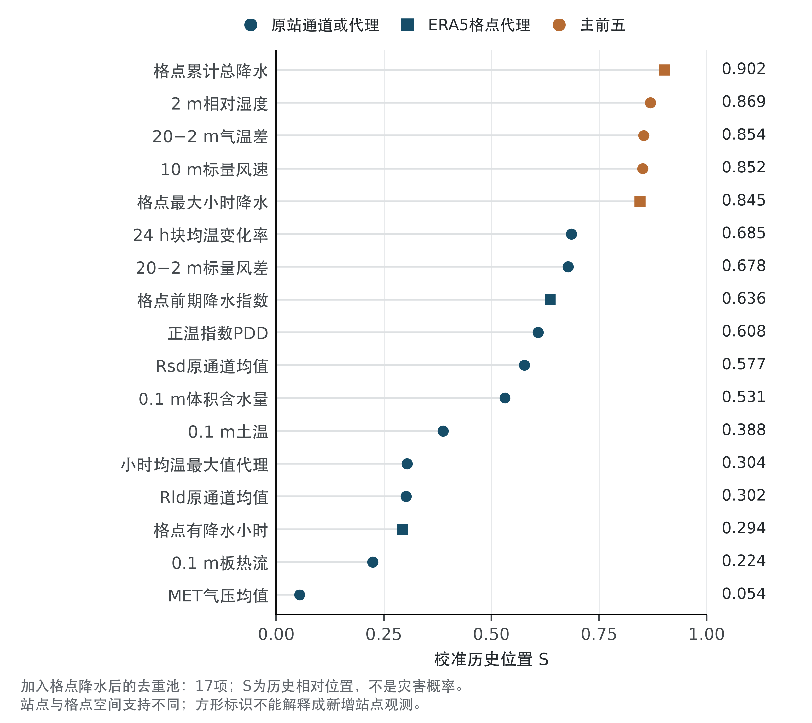

# 数学建模学习与成果

这里整理我的数学建模比赛成果、论文模板和学习笔记，记录从问题讨论、文献阅读到计算、验证与成稿的完整过程。希望这些可运行的程序、真实结果和写作示例，能为正在学习数学建模的同学提供参考。

## 内容导航

| 想看什么 | 从这里开始 |
|---|---|
| 一次完整的四问建模与论文 | [2026 MathorCup 大数据 B 赛道](competitions/2026-mathorcup-b/README.md) |
| 直接阅读论文 | [吉隆灾害链的环境特征、触发条件、预警与仿真](competitions/2026-mathorcup-b/paper/paper.pdf) |
| 复用论文结构与排版 | [LaTeX 论文模板](templates/paper-latex/README.md) · [独立下载](downloads/paper-latex-template.zip) |
| 学习如何组织建模工作 | [协作流程与比赛经验](notes/workflow-and-lessons.md) |
| 查找方法和数据出处 | [文献与资料索引](reading/README.md) |

## 比赛成果

### 2026 MathorCup 大数据 B 赛道

围绕吉隆灾害链，依次研究环境异常、局部材料临界条件、条件首达时间与预警、规定入口下的二维传播。目录包含论文、四问程序、必要输入与计算结果、图件，以及可按步骤运行的说明。

| 问题 | 方法与学习重点 |
|---|---|
| Q1 环境特征 | 多尺度历史校准、排序与 PCA；区分异常关注特征和致灾因果 |
| Q2 局部临界条件 | 饱和材料柱、剪胀—排水—孔压耦合；解释初态和近似适用范围 |
| Q3 时间与条件预警 | 首达映射、概率积分、稳健集合与 GP 比较；区分模拟保证和自然预测 |
| Q4 传播与核验 | 二维浅流仿真、多保真 GP、临界压力测试与物理核验 |

[阅读成果与图表](competitions/2026-mathorcup-b/README.md) · [查看复现步骤](competitions/2026-mathorcup-b/docs/reproduction.md)

图示为固定数据与窗口下的环境特征分析，排序不直接表示致灾贡献。

## 模板与工作流

- [论文 LaTeX 模板](templates/paper-latex/README.md)：包含摘要、问题分析、模型建立与求解、评价、参考文献和附录，可增减问题数量。
- [数学建模 Skills](https://github.com/zikkfvll/mathmodel-skills)：与本库配套的总控、分问研究审核、编程和论文写作工作流。
- [HNUST Beamer 模板](https://github.com/zikkfvll/hnust-beamer-template)：用于课程与文献汇报，单独维护。

## 如何使用这些材料

学习方法时，建议先读具体比赛的研究对象与假设，再对照程序、结果和图表。复现计算时按说明建立环境，并将新输出写到独立目录。复用模板时保留结构和排版，将示例文字、符号、公式及图表替换为自己的研究内容。

各次比赛的参数、阈值和结论都有对应的条件，不能直接移用到新题。数据与第三方材料的来源、许可和引用要求保存在各目录；本库不分发赛事原始大附件、第三方论文全文或个人签名材料。
