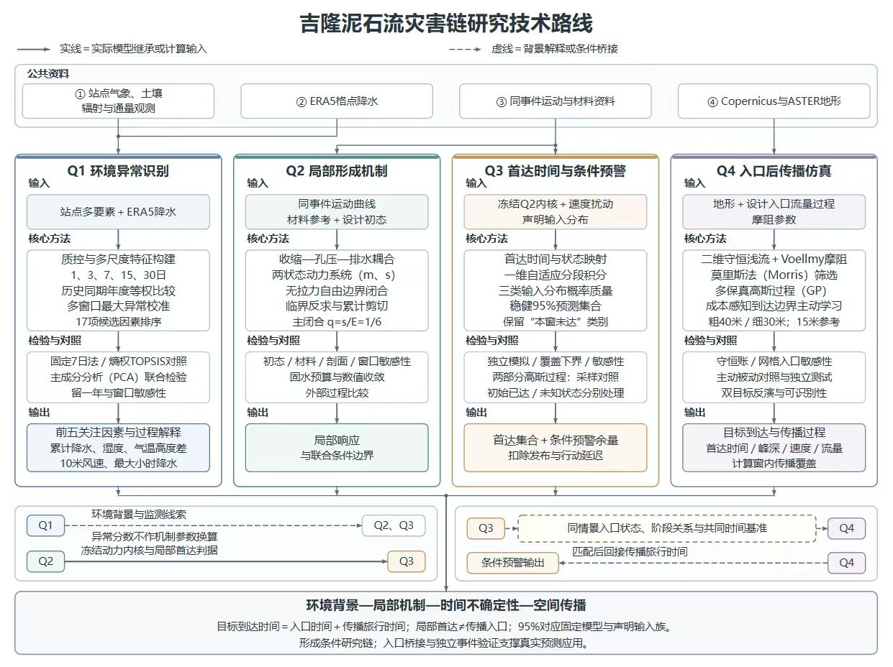

# 2026 MathorCup 大数据 B：吉隆灾害链建模

本研究将吉隆灾害链拆分为环境背景、局部临界条件、条件时间预测和传播四个问题，结合资料分析、动力模型、概率计算与二维仿真，讨论各阶段能够得到的答案及其衔接条件。

**[阅读论文 PDF](paper/paper.pdf)** · **[复现指南](docs/reproduction.md)** · **[图件目录](paper/figures/)** · **[数据来源](reproduction/数据来源与许可.txt)**

论文前30页为摘要、目录、正文、参考文献与声明；其后为完整程序附录。希望快速了解研究时，先阅读前30页即可。

## 四问内容

| 问题 | 研究对象 | 程序与结果 | 补充阅读 |
|---|---|---|---|
| Q1 | 环境特征的多尺度异常与排序 | [q1](reproduction/q1/) | [三方法对照](paper/Q1_SUPPORTING_ANALYSES.md) |
| Q2 | 充分饱和细粒基质的局部临界边界 | [q2](reproduction/q2/) | [数值设置与材料对照](paper/Q2_SUPPLEMENTARY_ANALYSES.md) |
| Q3 | 固定模型与分布下的首达时间、稳健集合和条件余量 | [q3](reproduction/q3/) | [概率、代理与敏感性分析](paper/Q3_SUPPORTING_ANALYSES.md) |
| Q4 | 规定入口后的二维传播与发布核验 | [q4](reproduction/q4/) | [多保真比较、反演与临界测试](paper/Q4_SUPPORTING_ANALYSES.md) |



## 目录

```text
2026-mathorcup-b/
├── paper/                  论文 PDF、LaTeX 工程、图件与补充分析
│   ├── paper.pdf
│   ├── main.tex
│   ├── figures/
│   └── appendix_code/      论文源码附录
├── reproduction/
│   ├── q1/                 各问程序、输入和结果
│   ├── q2/
│   ├── q3/
│   ├── q4/
│   └── prepare/            原附件清理、ERA5下载与路线转换
└── docs/reproduction.md     环境、命令与运行注意事项
```

已有结果和图表可以直接阅读，无需先运行全部程序。需要重绘或重新求解时，先按[复现指南](docs/reproduction.md)安装相应依赖；Q1—Q3分别从各问目录运行，Q4从`reproduction/`运行，并为新输出指定新目录。

## 结果应如何理解

Q1的排序衡量指定历史背景中的环境异常，不等同于致灾因果权重。Q2的临界条件属于声明初态与材料假设下的局部材料柱，不能直接解释为整股泥石流首次形成。Q3的概率保证针对固定动力模型和指定输入族；其中1000 m目标是理想常坡上的合成示例。Q4从规定入口计算传播，局部首达与整股入口之间仍需要真实资料建立桥接。

研究保留了窗内未达、近似偏差、原GP误判和未完成的压力测试等结果。实际应用于地方预警时，还需当地初态、驱动、地形与到达资料的外部验证。

## 继续阅读

- [论文工程与编译](paper/README.md)
- [各问如何衔接](paper/Q4_INTEGRATION_NOTES.md)
- [数据及工具说明](paper/SOURCE_AND_DISCLOSURE.md)
- [论文版本记录](paper/VERSION_RECORD.md)
- [数据与文件记录](PUBLICATION_MANIFEST.json)

Open-Meteo/ERA5、路线和Blatten派生资料保留其归属；地形数据按随附许可使用。完整说明见[数据来源与许可](reproduction/数据来源与许可.txt)和[许可目录](paper/DATA_LICENSES/)。完整官方原始附件需通过赛事渠道取得。
