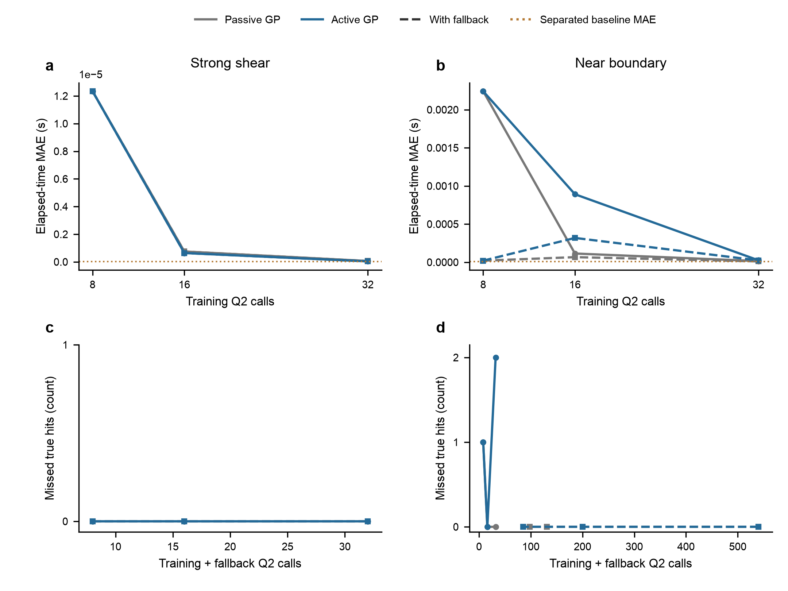
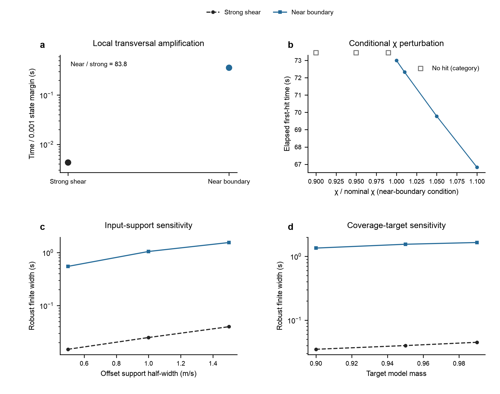

# 问题三补充分析与证据记录

本文件保留整合正文未展开的代理比较、全部预算与成本、条件延迟、数值诊断、未采用路线及来源。资料来自 `../Q3_final_polish_20261030_v4_1/Q3_submission/` 的原文及持久化结果，正文源文件 `Q3_paper.md` 的 SHA-256 为 `1d339aeb1b6e3feee23bccfa026776c63e7f507f5baeb1a28373b6452d3481e3`。本次整合按既有文件整理，未训练、求解、生成新随机标签或重绘数据图。表中时间来自原次执行的计时，随硬件及运行环境变化。

## 对象及方法身份

原模型固定问题二局部动力内核与二次压力剖面边界 $q_c=1/6$。参考速度是同次事件事后反演的读图曲线，时间原点为选定窗起点 $t_{ref}=27$ s，窗长73 s；它不是已观测的物理施剪起点或实际发布钟点。先在所有速度节点上加入同一个偏移 $d$、逐节点截零，再分段线性插值；采用三种声明的偏移分布，主概率实验取 $q_0=0.50$、$a=1.5$ m/s 和强施剪或近临界的两个设计 $\chi$。

首达、窗内未达、初始已达、未知是不同结果类别。未达不记为73 s事件，也不给予无穷预警余量；初始已达与未知保留为单独类别，不删去重归一化。速度偏移分布是计算设定；其形状、初态与条件施剪并未拟合成当地自然事件的概率分布。

有限首达响应构造自适应分段映射，并在有限段采用 PCHIP 保形插值，按各输入族的CDF反解积分。集合最短性针对共同的固定时间网格。连续积分所得到的稳健集合在强施剪条件为 [0.775, 0.815] s，最坏族质量0.9757986099259285；近临界条件为 [71.40, 72.95] s 加窗内未达类别，最坏族质量0.9642968635405905。最坏族均为均匀族。类别分界未解条带保留未知质量，近临界三族分别约为 $5.95\times10^{-8}$、$2.98\times10^{-8}$、$2.99\times10^{-8}$；强施剪三族未达及未解质量为零。

原 `results/set_comparison.json` 是每条件600个固定中点的代理诊断，direct稳健集合端点恰与连续积分主集合一致，但其最坏族质量分别为0.975、0.9633333333；近临界名义中央为 [71.7,73]，名义最短为 [71.8,73]。这些中点诊断的质量和名义端点与 `results/baseline_results.json` 的连续积分主表属于不同统计对象，不能互换。

冻结后的两个主候选、三族各抽4096个成员，共24576个模拟成员。目标漏覆盖率 $\alpha_{cov}=0.05$，有限模拟共同错误预算 $\delta=0.05$，六项声明各分配 $\delta/6$，采用单侧精确二项下界。强施剪和近临界的最低下界分别为0.9700025484701945、0.9560105835981271；其保证对象是固定动力模型、指定初态、两个原施剪条件、速度偏移支持及声明分布族下的模拟包含概率。600个固定中点不是独立二项样本；24576个模拟成员不是24576个自然灾害事件。更改初态、$\chi$、支持或覆盖目标的新诊断不继承这六项下界。

## 两部分GP、主动与非主动比较

GP分类器使用 Matérn-3/2 核；有限首达回归仅使用首达标签，核为常数幅值乘 Matérn-5/2。单类别按实际分支处理。均值和硬分类近似确定性首达映射；GP标准差用于选点与回退，不解释为自然灾害概率。主动和非主动使用相同8个初始标签，并比较8、16、32个训练标签：非主动填补最大输入间距；主动补充分类边界和高回归不确定性位置。候选池在输入边缘，诊断集为每条件600个固定中点，按完整路径分区；这不是自然事件样本。受时变可靠性主动学习思想启发，并未复现两篇引用工作的完整性能函数与算法流程。

以下原始表完整保留所有预算、原始/回退及 `all`/`boundary` 子集。`mae_s`、`max_abs_error_s`、`rmse_s` 均针对真实与预测均为有限首达的子集，必须与误判、未知和调用数一起看；boundary 子集大小为零时空值不表示零误差。`false_negative` 是真实首达漏判，`false_positive` 为非首达误判为首达，`unknown_predictions` 是代理未判定数。时间字段是原次执行的墙钟时间。来源：`results/gp_metrics.csv`。

```csv
regime,method,budget,mode,fallback_calls,fallback_wall_s,total_nominal_q2_calls,total_nominal_wall_s,subset,n,n_true_hit,n_both_hit,mae_s,max_abs_error_s,rmse_s,false_negative,false_positive,unknown_predictions,class_error_rate
strong,passive,8,raw,0,0.0,8,0.08475754223763943,all,600,600,600,1.2337509787923213e-05,5.079378540384649e-05,1.8805146881378347e-05,0,0,0,0.0
strong,passive,8,raw,0,0.0,8,0.08475754223763943,boundary,0,0,0,,,,0,0,0,
strong,passive,8,fallback,0,3.787502646446228e-05,8,0.0848610419780016,all,600,600,600,1.2337509787923213e-05,5.079378540384649e-05,1.8805146881378347e-05,0,0,0,0.0
strong,passive,8,fallback,0,3.787502646446228e-05,8,0.0848610419780016,boundary,0,0,0,,,,0,0,0,
strong,passive,16,raw,0,0.0,16,0.17538533289916813,all,600,600,600,7.494865199114686e-07,7.493936516445032e-06,1.7029449534363877e-06,0,0,0,0.0
strong,passive,16,raw,0,0.0,16,0.17538533289916813,boundary,0,0,0,,,,0,0,0,
strong,passive,16,fallback,0,3.383401781320572e-05,16,0.1754767089150846,all,600,600,600,7.494865199114686e-07,7.493936516445032e-06,1.7029449534363877e-06,0,0,0,0.0
strong,passive,16,fallback,0,3.383401781320572e-05,16,0.1754767089150846,boundary,0,0,0,,,,0,0,0,
strong,passive,32,raw,0,0.0,32,0.3570224158465862,all,600,600,600,5.959943577123668e-08,1.0148094419237808e-06,1.924428582600044e-07,0,0,0,0.0
strong,passive,32,raw,0,0.0,32,0.3570224158465862,boundary,0,0,0,,,,0,0,0,
strong,passive,32,fallback,0,2.908310852944851e-05,32,0.3570810412056744,all,600,600,600,5.959943577123668e-08,1.0148094419237808e-06,1.924428582600044e-07,0,0,0,0.0
strong,passive,32,fallback,0,2.908310852944851e-05,32,0.3570810412056744,boundary,0,0,0,,,,0,0,0,
strong,active,8,raw,0,0.0,8,0.07296695816330612,all,600,600,600,1.2337509787923213e-05,5.079378540384649e-05,1.8805146881378347e-05,0,0,0,0.0
strong,active,8,raw,0,0.0,8,0.07296695816330612,boundary,0,0,0,,,,0,0,0,
strong,active,8,fallback,0,3.804219886660576e-05,8,0.07303916639648378,all,600,600,600,1.2337509787923213e-05,5.079378540384649e-05,1.8805146881378347e-05,0,0,0,0.0
strong,active,8,fallback,0,3.804219886660576e-05,8,0.07303916639648378,boundary,0,0,0,,,,0,0,0,
strong,active,16,raw,0,0.0,16,0.1658001272007823,all,600,600,600,6.384463762202733e-07,5.753469110469922e-06,1.3487078313443238e-06,0,0,0,0.0
strong,active,16,raw,0,0.0,16,0.1658001272007823,boundary,0,0,0,,,,0,0,0,
strong,active,16,fallback,0,2.987496554851532e-05,16,0.1657749603036791,all,600,600,600,6.384463762202733e-07,5.753469110469922e-06,1.3487078313443238e-06,0,0,0,0.0
strong,active,16,fallback,0,2.987496554851532e-05,16,0.1657749603036791,boundary,0,0,0,,,,0,0,0,
strong,active,32,raw,0,0.0,32,0.3505685441195965,all,600,600,600,3.360762798073254e-08,5.373960131338507e-07,9.784607923410877e-08,0,0,0,0.0
strong,active,32,raw,0,0.0,32,0.3505685441195965,boundary,0,0,0,,,,0,0,0,
strong,active,32,fallback,0,2.7625123038887978e-05,32,0.3507018352393061,all,600,600,600,3.360762798073254e-08,5.373960131338507e-07,9.784607923410877e-08,0,0,0,0.0
strong,active,32,fallback,0,2.7625123038887978e-05,32,0.3507018352393061,boundary,0,0,0,,,,0,0,0,
near,passive,8,raw,0,0.0,8,0.4586701672524214,all,600,301,300,0.0022415491933756946,0.020583993805900036,0.004209029929538607,1,0,0,0.0016666666666666668
near,passive,8,raw,0,0.0,8,0.4586701672524214,boundary,32,17,16,0.01532950184454851,0.020583993805900036,0.015633648188427458,1,0,0,0.03125
near,passive,8,fallback,532,33.166155957849696,540,33.62658099993132,all,600,301,301,2.0047492838134425e-05,0.0002541278659435875,6.460068360521911e-05,0,0,0,0.0
near,passive,8,fallback,532,33.166155957849696,540,33.62658099993132,boundary,32,17,17,0.0,0.0,0.0,0,0,0,0.0
near,passive,16,raw,0,0.0,16,0.9264018340036273,all,600,301,301,0.00011375320551058302,0.0006171522495037607,0.00018238837595372235,0,0,21,0.035
near,passive,16,raw,0,0.0,16,0.9264018340036273,boundary,32,0,0,,,,0,0,16,0.5
near,passive,16,fallback,115,7.3920657080598176,131,8.326627209084108,all,600,301,301,6.611315139507217e-05,0.00042097050751976894,0.00010916859471760448,0,0,0,0.0
near,passive,16,fallback,115,7.3920657080598176,131,8.326627209084108,boundary,32,0,0,,,,0,0,0,0.0
near,passive,32,raw,0,0.0,32,1.8888413331005722,all,600,301,301,1.4448818731646579e-05,0.00011008325026296006,2.5942195327788337e-05,0,0,9,0.015
near,passive,32,raw,0,0.0,32,1.8888413331005722,boundary,32,7,7,4.12297011779726e-05,7.228417470628301e-05,4.7276954947944755e-05,0,0,9,0.28125
near,passive,32,fallback,66,4.241186207858846,98,6.129577915882692,all,600,301,301,1.059075828911705e-05,0.00011008325026296006,2.051167766648702e-05,0,0,0,0.0
near,passive,32,fallback,66,4.241186207858846,98,6.129577915882692,boundary,32,7,7,0.0,0.0,0.0,0,0,0,0.0
near,active,8,raw,0,0.0,8,0.45846666605211794,all,600,301,300,0.0022415491933756946,0.020583993805900036,0.004209029929538607,1,0,0,0.0016666666666666668
near,active,8,raw,0,0.0,8,0.45846666605211794,boundary,32,17,16,0.01532950184454851,0.020583993805900036,0.015633648188427458,1,0,0,0.03125
near,active,8,fallback,532,33.34179433318786,540,33.79931924934499,all,600,301,301,2.0047492838134425e-05,0.0002541278659435875,6.460068360521911e-05,0,0,0,0.0
near,active,8,fallback,532,33.34179433318786,540,33.79931924934499,boundary,32,17,17,0.0,0.0,0.0,0,0,0,0.0
near,active,16,raw,0,0.0,16,0.9534332922194153,all,600,301,301,0.000890897241343222,0.003617428210290541,0.001411306026631648,0,0,5,0.008333333333333333
near,active,16,raw,0,0.0,16,0.9534332922194153,boundary,32,11,11,2.0491055069142433e-05,5.443817624950498e-05,2.769675397930507e-05,0,0,5,0.15625
near,active,16,fallback,184,15.083871624898165,200,16.041938083944842,all,600,301,301,0.0003182106285809413,0.0018311778885617969,0.0005235333945254951,0,0,0,0.0
near,active,16,fallback,184,15.083871624898165,200,16.041938083944842,boundary,32,11,11,0.0,0.0,0.0,0,0,0,0.0
near,active,32,raw,0,0.0,32,1.9246213340666145,all,600,301,299,2.485903475774247e-05,0.00012954957247757193,3.359688648787893e-05,2,0,0,0.0033333333333333335
near,active,32,raw,0,0.0,32,1.9246213340666145,boundary,32,18,16,1.1977628879833446e-05,7.066322619664334e-05,2.3342933573821698e-05,2,0,0,0.0625
near,active,32,fallback,53,4.2334777500946075,85,6.159122375072911,all,600,301,301,2.352642817547735e-05,0.00012954957247757193,3.248082704794529e-05,0,0,0,0.0
near,active,32,fallback,53,4.2334777500946075,85,6.159122375072911,boundary,32,18,18,0.0,0.0,0.0,0,0,0,0.0
```

32标签时，近临界主动原始预测漏判2个真实首达；回退后漏判为0，训练加回退总调用为85。非主动原始结果有9个未知，回退后未知为0，总调用为98。固定中点有限首达时间误差小并不能替代类别检查。在本一维输入和预算范围内，主动方法没有稳定的全面优势；主概率任务采用可复用分段映射及解析CDF积分。这一取舍不推断主动学习在其他任务普遍无效。



图中有限时间误差与首达漏判分开展示；回退增加的动力内核调用计入成本。有关初始样本、训练曲线和逐次回退明细分别见 `results/gp_training.json`、`results/gp_training_summary.json`、`results/fallback_queries.jsonl` 和 `results/gp/`。

## 全部预算成本和连续积分成本

原次结果将构建、同600输入查询与回退、三族概率集合任务、首次使用、重复使用及调用数分开记录。下表保留原始列和全部预算；`continuous_integral_extra_wall_s` 及其总计针对连续主任务，`metric_diagnostic_extra_wall_s` 是额外诊断计时。不同列及不同方法工作量不尽相同，不以跨任务计时直接推导统一加速倍数。来源：`results/cost_comparison.csv`。

```csv
regime,method,budget,mode,construction_wall_s,query_wall_s,probability_set_wall_s,first_use_total_wall_s,repeat_query_total_wall_s,construction_q2_calls,fallback_q2_calls,continuous_integral_extra_wall_s,primary_continuous_first_use_total_wall_s,primary_continuous_repeat_use_wall_s,metric_diagnostic_extra_wall_s
strong,Direct Q2,600,direct,0.0,4.6330406670458615,0.008858375018462539,4.641899042064324,4.641899042064324,0,600,,,,
strong,1D baseline,97,interpolation,1.2947545000351965,6.433296948671341e-05,0.00927404104731977,1.304092874052003,0.009338374016806483,97,0,1.5617188750766218,2.8564733751118183,1.5617188750766218,
strong,passive GP,8,raw,0.07547379098832607,0.0004055420868098736,0.008878209162503481,0.08475754223763943,0.009283751249313354,8,0,,,,0.027488499879837036
strong,passive GP,8,fallback,0.07547379098832607,0.00044341711327433586,0.008943833876401186,0.0848610419780016,0.009387250989675522,8,0,,,,0.02716449904255569
strong,passive GP,16,raw,0.1661695409566164,0.0004507920239120722,0.00876499991863966,0.17538533289916813,0.009215791942551732,16,0,,,,0.026969667058438063
strong,passive GP,16,fallback,0.1661695409566164,0.0004846260417252779,0.008822541916742921,0.1754767089150846,0.009307167958468199,16,0,,,,0.027040291111916304
strong,passive GP,32,raw,0.3474718329962343,0.0005198749713599682,0.009030707878991961,0.3570224158465862,0.00955058285035193,32,0,,,,0.02693300019018352
strong,passive GP,32,fallback,0.3474718329962343,0.0005489580798894167,0.009060250129550695,0.3570810412056744,0.009609208209440112,32,0,,,,0.027082249987870455
strong,active GP,8,raw,0.06367095815949142,0.0004159579984843731,0.008880042005330324,0.07296695816330612,0.009296000003814697,8,0,,,,0.02732412493787706
strong,active GP,8,fallback,0.06367095815949142,0.00045400019735097885,0.00891420803964138,0.07303916639648378,0.00936820823699236,8,0,,,,0.027923583751544356
strong,active GP,16,raw,0.15645462623797357,0.0004539589863270521,0.008891541976481676,0.1658001272007823,0.009345500962808728,16,0,,,,0.02687270799651742
strong,active GP,16,fallback,0.15645462623797357,0.00048383395187556744,0.00883650011382997,0.1657749603036791,0.009320334065705538,16,0,,,,0.026992915896698833
strong,active GP,32,raw,0.34129391820169985,0.0005098339170217514,0.008764792000874877,0.3505685441195965,0.009274625917896628,32,0,,,,0.027302041882649064
strong,active GP,32,fallback,0.34129391820169985,0.0005374590400606394,0.0088704579975456,0.3507018352393061,0.00940791703760624,32,0,,,,0.027030750177800655
near,Direct Q2,600,direct,0.0,35.35322195896879,0.011432084022089839,35.36465404299088,35.36465404299088,0,600,,,,
near,1D baseline,124,interpolation,7.133473417023197,6.445893086493015e-05,0.011229833122342825,7.144767709076405,0.011294292053207755,124,0,0.9121229590382427,8.04559637606144,0.9121229590382427,
near,passive GP,8,raw,0.4465852500870824,0.0006494170520454645,0.011435500113293529,0.4586701672524214,0.012084917165338993,8,0,,,,0.026053665904328227
near,passive GP,8,fallback,0.4465852500870824,33.16680537490174,0.013190374942496419,33.62658099993132,33.17999574984424,8,532,,,,0.028620125027373433
near,passive GP,16,raw,0.9206443750299513,0.0007813340052962303,0.004976124968379736,0.9264018340036273,0.005757458973675966,16,0,,,,0.02772716712206602
near,passive GP,16,fallback,0.9206443750299513,7.392847042065114,0.013135791989043355,8.326627209084108,7.405982834054157,16,115,,,,0.04710929188877344
near,passive GP,32,raw,1.8748103331308812,0.0010619999375194311,0.012969000032171607,1.8888413331005722,0.014030999969691038,32,0,,,,0.027259291848167777
near,passive GP,32,fallback,1.8748103331308812,4.242248207796365,0.012519374955445528,6.129577915882692,4.2547675827518106,32,66,,,,0.02766279107891023
near,active GP,8,raw,0.4450552500784397,0.0008045409340411425,0.012606875039637089,0.45846666605211794,0.013411415973678231,8,0,,,,0.02608104096725583
near,active GP,8,fallback,0.4450552500784397,33.342598874121904,0.011665125144645572,33.79931924934499,33.35426399926655,8,532,,,,0.026212916942313313
near,active GP,16,raw,0.941016125259921,0.0008495838847011328,0.01156758307479322,0.9534332922194153,0.012417166959494352,16,0,,,,0.02695633308030665
near,active GP,16,fallback,0.941016125259921,15.084721208782867,0.016200749902054667,16.041938083944842,15.100921958684921,16,184,,,,0.03571925009600818
near,active GP,32,raw,1.9098637921269983,0.0012640419881790876,0.013493499951437116,1.9246213340666145,0.014757541939616203,32,0,,,,0.03604666702449322
near,active GP,32,fallback,1.9098637921269983,4.234741792082787,0.014516790863126516,6.159122375072911,4.249258582945913,32,53,,,,0.032756751170381904
```

连续主任务在映射构建之后分别耗时1.561719 s（强施剪）和0.912123 s（近临界）；构建加连续积分首次总耗时分别为2.856473 s和8.045596 s。数值的精确原始版本见上表，其基准不是600查询任务。

## 完整局部预警延迟结果

设局部首达相对时刻为 $\tau_L$，假设发布延迟为 $d_{pub}$、行动时长为 $d_{act}$，则有限局部余量 $L_L=\tau_L-d_{pub}-d_{act}$，是对相同预测集合的确定平移。下表为两条件、5个发布延迟与4个行动延迟的全部40行；近临界的窗内未达标志保留，不能解释成无限余量。发布与行动延迟均是设定情景，不是已验证实际发行成绩。`finite_all_positive`、`finite_all_nonpositive` 只描述有限部分；`certification_passed` 指源包给定候选、输入分布和模拟声明条件的认证状态，不是自然事件外验。来源：`results/lead_margins.csv`。

```csv
regime,candidate,publication_delay_s,action_delay_s,finite_lower_s,finite_upper_s,includes_no_hit,unknown_mass,finite_width_s,finite_all_positive,finite_all_nonpositive,certification_passed,identity
strong,strong_robust,0,0,0.775,0.815,False,0.0,0.039999999999999925,True,False,True,"translated frozen local set; delays hypothetical, no infinite lead assigned to no_hit"
strong,strong_robust,0,5,-4.225,-4.1850000000000005,False,0.0,0.039999999999999925,False,True,True,"translated frozen local set; delays hypothetical, no infinite lead assigned to no_hit"
strong,strong_robust,0,15,-14.225,-14.185,False,0.0,0.039999999999999925,False,True,True,"translated frozen local set; delays hypothetical, no infinite lead assigned to no_hit"
strong,strong_robust,0,30,-29.225,-29.185,False,0.0,0.039999999999999925,False,True,True,"translated frozen local set; delays hypothetical, no infinite lead assigned to no_hit"
strong,strong_robust,1,0,-0.22499999999999998,-0.18500000000000005,False,0.0,0.039999999999999925,False,True,True,"translated frozen local set; delays hypothetical, no infinite lead assigned to no_hit"
strong,strong_robust,1,5,-5.225,-5.1850000000000005,False,0.0,0.039999999999999925,False,True,True,"translated frozen local set; delays hypothetical, no infinite lead assigned to no_hit"
strong,strong_robust,1,15,-15.225,-15.185,False,0.0,0.039999999999999925,False,True,True,"translated frozen local set; delays hypothetical, no infinite lead assigned to no_hit"
strong,strong_robust,1,30,-30.225,-30.185,False,0.0,0.039999999999999925,False,True,True,"translated frozen local set; delays hypothetical, no infinite lead assigned to no_hit"
strong,strong_robust,5,0,-4.225,-4.1850000000000005,False,0.0,0.039999999999999925,False,True,True,"translated frozen local set; delays hypothetical, no infinite lead assigned to no_hit"
strong,strong_robust,5,5,-9.225,-9.185,False,0.0,0.039999999999999925,False,True,True,"translated frozen local set; delays hypothetical, no infinite lead assigned to no_hit"
strong,strong_robust,5,15,-19.225,-19.185000000000002,False,0.0,0.039999999999999925,False,True,True,"translated frozen local set; delays hypothetical, no infinite lead assigned to no_hit"
strong,strong_robust,5,30,-34.225,-34.185,False,0.0,0.039999999999999925,False,True,True,"translated frozen local set; delays hypothetical, no infinite lead assigned to no_hit"
strong,strong_robust,30,0,-29.225,-29.185,False,0.0,0.039999999999999925,False,True,True,"translated frozen local set; delays hypothetical, no infinite lead assigned to no_hit"
strong,strong_robust,30,5,-34.225,-34.185,False,0.0,0.039999999999999925,False,True,True,"translated frozen local set; delays hypothetical, no infinite lead assigned to no_hit"
strong,strong_robust,30,15,-44.225,-44.185,False,0.0,0.039999999999999925,False,True,True,"translated frozen local set; delays hypothetical, no infinite lead assigned to no_hit"
strong,strong_robust,30,30,-59.225,-59.185,False,0.0,0.039999999999999925,False,True,True,"translated frozen local set; delays hypothetical, no infinite lead assigned to no_hit"
strong,strong_robust,60,0,-59.225,-59.185,False,0.0,0.039999999999999925,False,True,True,"translated frozen local set; delays hypothetical, no infinite lead assigned to no_hit"
strong,strong_robust,60,5,-64.225,-64.185,False,0.0,0.039999999999999925,False,True,True,"translated frozen local set; delays hypothetical, no infinite lead assigned to no_hit"
strong,strong_robust,60,15,-74.225,-74.185,False,0.0,0.039999999999999925,False,True,True,"translated frozen local set; delays hypothetical, no infinite lead assigned to no_hit"
strong,strong_robust,60,30,-89.225,-89.185,False,0.0,0.039999999999999925,False,True,True,"translated frozen local set; delays hypothetical, no infinite lead assigned to no_hit"
near,near_robust,0,0,71.4,72.95,True,5.9502317739656974e-08,1.5499999999999972,True,False,True,"translated frozen local set; delays hypothetical, no infinite lead assigned to no_hit"
near,near_robust,0,5,66.4,67.95,True,5.9502317739656974e-08,1.5499999999999972,True,False,True,"translated frozen local set; delays hypothetical, no infinite lead assigned to no_hit"
near,near_robust,0,15,56.400000000000006,57.95,True,5.9502317739656974e-08,1.5499999999999972,True,False,True,"translated frozen local set; delays hypothetical, no infinite lead assigned to no_hit"
near,near_robust,0,30,41.400000000000006,42.95,True,5.9502317739656974e-08,1.5499999999999972,True,False,True,"translated frozen local set; delays hypothetical, no infinite lead assigned to no_hit"
near,near_robust,1,0,70.4,71.95,True,5.9502317739656974e-08,1.5499999999999972,True,False,True,"translated frozen local set; delays hypothetical, no infinite lead assigned to no_hit"
near,near_robust,1,5,65.4,66.95,True,5.9502317739656974e-08,1.5499999999999972,True,False,True,"translated frozen local set; delays hypothetical, no infinite lead assigned to no_hit"
near,near_robust,1,15,55.400000000000006,56.95,True,5.9502317739656974e-08,1.5499999999999972,True,False,True,"translated frozen local set; delays hypothetical, no infinite lead assigned to no_hit"
near,near_robust,1,30,40.400000000000006,41.95,True,5.9502317739656974e-08,1.5499999999999972,True,False,True,"translated frozen local set; delays hypothetical, no infinite lead assigned to no_hit"
near,near_robust,5,0,66.4,67.95,True,5.9502317739656974e-08,1.5499999999999972,True,False,True,"translated frozen local set; delays hypothetical, no infinite lead assigned to no_hit"
near,near_robust,5,5,61.400000000000006,62.95,True,5.9502317739656974e-08,1.5499999999999972,True,False,True,"translated frozen local set; delays hypothetical, no infinite lead assigned to no_hit"
near,near_robust,5,15,51.400000000000006,52.95,True,5.9502317739656974e-08,1.5499999999999972,True,False,True,"translated frozen local set; delays hypothetical, no infinite lead assigned to no_hit"
near,near_robust,5,30,36.400000000000006,37.95,True,5.9502317739656974e-08,1.5499999999999972,True,False,True,"translated frozen local set; delays hypothetical, no infinite lead assigned to no_hit"
near,near_robust,30,0,41.400000000000006,42.95,True,5.9502317739656974e-08,1.5499999999999972,True,False,True,"translated frozen local set; delays hypothetical, no infinite lead assigned to no_hit"
near,near_robust,30,5,36.400000000000006,37.95,True,5.9502317739656974e-08,1.5499999999999972,True,False,True,"translated frozen local set; delays hypothetical, no infinite lead assigned to no_hit"
near,near_robust,30,15,26.400000000000006,27.950000000000003,True,5.9502317739656974e-08,1.5499999999999972,True,False,True,"translated frozen local set; delays hypothetical, no infinite lead assigned to no_hit"
near,near_robust,30,30,11.400000000000006,12.950000000000003,True,5.9502317739656974e-08,1.5499999999999972,True,False,True,"translated frozen local set; delays hypothetical, no infinite lead assigned to no_hit"
near,near_robust,60,0,11.400000000000006,12.950000000000003,True,5.9502317739656974e-08,1.5499999999999972,True,False,True,"translated frozen local set; delays hypothetical, no infinite lead assigned to no_hit"
near,near_robust,60,5,6.400000000000006,7.950000000000003,True,5.9502317739656974e-08,1.5499999999999972,True,False,True,"translated frozen local set; delays hypothetical, no infinite lead assigned to no_hit"
near,near_robust,60,15,-3.5999999999999943,-2.049999999999997,True,5.9502317739656974e-08,1.5499999999999972,False,True,True,"translated frozen local set; delays hypothetical, no infinite lead assigned to no_hit"
near,near_robust,60,30,-18.599999999999994,-17.049999999999997,True,5.9502317739656974e-08,1.5499999999999972,False,True,True,"translated frozen local set; delays hypothetical, no infinite lead assigned to no_hit"
```

## 其他敏感性和检查

- 646个无权重设计情景由19个非均匀初态、17个速度偏移、两种施剪条件组成；强施剪323个首达，近临界179个首达和144个窗内未达，不赋自然事件概率。近临界 $q_0=0.50,d=0$ 时，$\chi$ 乘0.99为窗内未达，乘1.01首达72.33085193147878 s。另有42个条件施剪扰动记录和18个变量—步长记录；它们不能简单相加称为唯一求解次数。
- 两个名义点在同一假设 $\delta q=0.001$ 下的一阶横截时间单位分别为0.004281366525113463 s和0.3585658385065193 s，约83.8倍。这是局部状态裕量相同的横截响应，不是所有归一化输入敏感度或实测95%误差的倍率；近临界对应的窗末余量仅0.0029048826485649215 s。两个点排水项与剪切项绝对比为约 $1.8631\times10^{-5}$、0.001557，不能归因于两项强烈相消。
- 支持半宽0.5、1、1.5 m/s时，强施剪稳健有限宽度分别为0.015、0.025、0.040 s，近临界分别为0.55、1.05、1.55 s，近临界均保留窗内未达类别。原支持下三族未达质量依次为0.4982846811、0.4991416037、0.7491408669。90%和99%目标、缩窄支持以及新增初态与施剪情景为数值诊断，未另获原六声明的随机模拟保证。
- 原有六个代表性数值加严案例缩小相对容差10倍、最大步长减半，类别一致；5个有限首达时刻最大变化约 $1.98\times10^{-6}$ s。这是既有求解器稳定性核查，不是本次新增物理实验或自然触发时刻误差界。



完整设计和结果保留于原包 `results/sensitivity/phase_map.csv`、`chi_perturbation.csv`、`crossing_amplification.csv`、`local_derivatives.csv`、`derivative_step_stability.csv`、`set_sensitivity.csv`、`distribution_sensitivity.csv` 和 `legacy_numerical_convergence.csv`。这些设计不表示已测量的初态联合概率。

## 传播测试、未采用项及资料范围

空间示例使用8°理想常坡、厚度2 m、沿坡1000 m固定目标及从入口计180 s的传播窗口。五个无概率权重的Voellmy参数点中，S1 ($\mu=0.03,\xi=200$ m/s²)、S2 ($0.03,2000$) 与S5 ($0.09,399.0524629937759$) 的旅行时间分别为155.39477279593586、61.25996026913375、167.1465661890269 s；S3 ($0.13,200$) 和S4 ($0.13,2000$) 在180 s内未达。$\mu$ 为无量纲摩擦参数，$\xi$ 为有量纲湍流阻力参数。合成桥接设 $T_{in}=T_L+0$，以同一情景加旅行时长求目标到达与余量；局部首达并未因此被证明等于实际整股形成或入口。

来源 `data/q4_existing_five_ode_points.csv`、`results/q4_spatial_demo.csv`。后表200行对应两条件、五传播点、五发布及四行动延迟的组合：120条为有限到达，80条保留未达，不能作为200个独立自然事件，也不能将三到达/两未达解释为自然到达概率。1000 m是固定合成目标距离，不代表实际吉隆预警半径、连续危险区或停距。既有理想沟谷和代表DEM稿存在来源数组、接口或数字核对问题，未纳入该条件输出。

气象辅助缺少合格的长期预报—质控实测配对；未用模式档案冒充实测训练NGBoost，故没有报告NGBoost成绩或把其作为正文已实施方法。未来开展真实预警还需识别局部初态、未来驱动、实际钟点、局部首达到整股形成及传播入口的对应关系，以及同成员、同时间与目标的到达数据。原有源稿及独立审核的数值覆盖不等同于独立自然事件上的覆盖或发行成绩。

## 来源与方法文献

- 源正文 `../Q3_final_polish_20261030_v4_1/Q3_submission/Q3_paper.md`；对应分析代码、冻结配置、结果表、原始图和运行回执均保存在同一 `Q3_submission/` 目录。结果身份与精确取数另见 `../../reports/q123_writing_20261030/Q3_EVIDENCE_AUDIT.md` 及其 `evidence/Q3_EXACT_READBACK.json`。
- Dang C, Valdebenito M A, Faes M G R. Towards a single-loop Gaussian process regression based-active learning method for time-dependent reliability analysis. *Mechanical Systems and Signal Processing*, 2025, 226:112294. https://doi.org/10.1016/j.ymssp.2024.112294.
- Dang C, Valdebenito M A, Faes M G R. Time-dependent reliability analysis by a single-loop Bayesian active learning method using Gaussian process regression. *Computer Methods in Applied Mechanics and Engineering*, 2025, 444:118092. https://doi.org/10.1016/j.cma.2025.118092.
- Clopper C J, Pearson E S. The use of confidence or fiducial limits illustrated in the case of the binomial. *Biometrika*, 1934, 26(4):404–413. 本地SciPy条目核对方法名称与书目信息，本轮未获取期刊原文。单侧下界的实现依据及文档见 [SciPy proportion_ci](https://docs.scipy.org/doc/scipy/reference/generated/scipy.stats._result_classes.BinomTestResult.proportion_ci.html)。
- PCHIP 算法说明见 [SciPy PchipInterpolator](https://docs.scipy.org/doc/scipy/reference/generated/scipy.interpolate.PchipInterpolator.html)；Fritsch F N, Butland J. A method for constructing local monotone piecewise cubic interpolants. 1984, 5(2):300–304. https://doi.org/10.1137/0905021. 本轮为本地文档二级核对，未取得原刊全文。
- Duan T, Anand A, Ding D Y, et al. NGBoost: Natural Gradient Boosting for Probabilistic Prediction. ICML, PMLR, 2020, 119:2690–2700. https://proceedings.mlr.press/v119/duan20a.html. 此条用于记录未采用路线，不对应本项目已训练模型。
