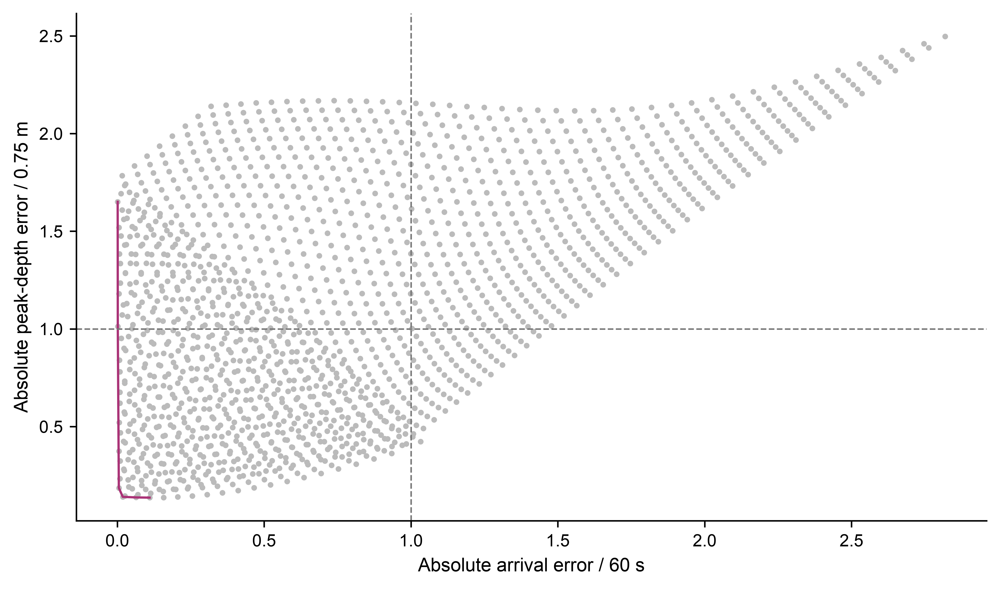
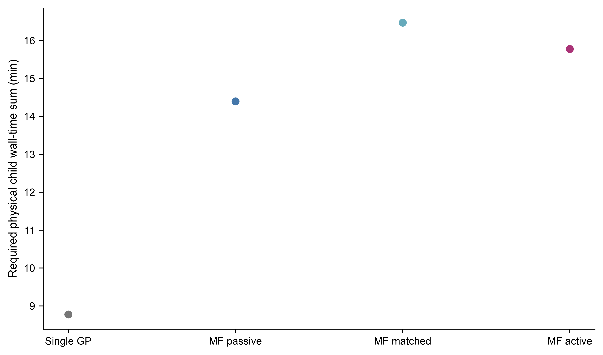

# 问题四补充分析、成本与条件记录

本文件保存Q1—Q4整合正文未展开的反演、完整对照、成本、验证、故障及未运行事项。材料来自相邻 `../Q4_upgrade_20261030/` 已完成的研究包，其主文 `PAPER.md` SHA-256 为 `c6a8be85520b31b642769d2f5ae86477b564d2db1606eb9a63423de8ef8ce502`；技术审核见项目 `reports/q4/final_review_20261030/FINAL_REVIEW.md`、`gp/deadline_seed137/FINAL_SCOPE_REVIEW.md`、`numerical/NEW_V30_MORRIS_TARGET_AND_COMPLETED_CASES_REVIEW.md` 与 `numerical/INVERSE_V30_SYNTHETIC_REVIEW.md`。本次论文整合仅读取已保存的材料，没有运行PDE、训练代理、重新反演或重绘数据图。源研究的受限结论与整合论文的新版本审核分开。

> **增量证据更新（2026-10-30）：** 下文保留v31基础包的旧24点与单seed事实；新增的真实临界压力测试显示，137主动组在四个临界端点错2/4，不能将旧24点零错判扩展为边界稳健优势。271对旧24为历史描述性回放，503未形成完整模型，三seed稳定性未完成。新增证据和原始结果见文末“后续增量”。

## 研究对象与时间、空间身份

事件流以人为规定的已形成流入口为相对时间0，输入体积、脉冲时长、入口速度、宽度和摩阻为设计条件。Q3局部材料柱达到孔压支承边界，并不直接给出Q4完整流的入口时刻或入口体积；未引入已核验的时间和状态桥接，因此不生成自然事件的绝对入口或口岸到达钟点。Q3的8°常坡、法向厚2 m、沿坡1000 m是不同的标量示例，不和Q4的水平坐标、竖直厚度传播模型拼接。Q3/Q4时间口径记录见源包 `results/Q3_Q4_TIME_SCOPE.json`。

Q4局部目标距入口沿参考轴线约2.119 km，完整河段口岸目标约14.188 km。两套目标各有空间支持和时窗；局部代理性能不代表口岸情景表现。Copernicus DEM GLO-30和ASTER GDEM V003分别建立单源连续地形支持；在同一源的支持上改变网格是离散层级，不同产品对比是地形结构情景。原产品15 m支持由插值得到，非新的15 m实测河床。固定床、常密度、干外域、无侵蚀夹带及无基流回水等条件应与结果一同理解。

断面瞬时最大竖直事件厚度首次达到0.1 m定义为到达，有限时间以相邻时间步首达括区表示。有效时窗未达、数值失败、非法出域、未运行分别记录；窗内未达不是永久未达。窗内曾超0.1 m覆盖面积与窗末瞬时覆盖面积是不同统计量；完整域末时仍有运动时不报告最终停距。断面深度、速度和流量以各自时间与位置配对，不以不同时间的极值乘积当作荷载。

## 合成反演、留出响应与不可辨识性

预注册合成观测采用 $V=7\times10^5$ m³、$\mu=0.04$、$T=960$ s、$\xi=500$ m/s²、入口速度30 m/s和宽30 m；15 m、半CFL模拟作为合成真值，候选模型为30 m。这是同一物理模型不同网格及时间步构造的离散失配试验，不是现场观测。合成真值首达括区为 [675.572283060, 675.641409458] s，目标峰深10.292181963 m，目标下游有符号峰值流量676.201806331 m³/s。

30 m候选库为 $V\in[6\times10^5,8\times10^5]$ m³、$\mu\in[0.03,0.05]$ 的4×4设计，拟合后在41×41网格上比较1681个代理候选；到时与峰深误差分别以60 s和0.75 m归一化，二者为预设比较尺度。单到时兼容数1138，加入峰深后634。它们是代理均值网格候选数，不是1681次PDE、自然后验概率或连续域置信集。实际完成1次15 m真值、16次30 m库和2个不同代表点返算，共19次真实运行。

| 返算代表 | 参数 | 实际到时绝对误差/s | 实际峰深绝对误差/m | 留出峰值流量绝对误差/(m³/s) |
|---|---|---:|---:|---:|
| 到时误差最小 | $V=6.5\times10^5$ m³，$\mu=0.031$ | 0.337602 | 1.204754 | 114.115193 |
| 双目标兼顾 | $V=8\times10^5$ m³，$\mu=0.0425$ | 6.732116 | 0.083576 | 194.816765 |

峰值流量不参与拟合或代表点选择，是同一合成模拟的留出响应；双目标兼顾使本例两约束更匹配，但留出流量误差反而增大。真参数位于代理网格中，其30 m代理到时为711.060981 s、峰深9.471063 m，对应归一误差0.590902、1.094826：满足单到时尺度却被双约束兼容集排除。双目标收缩及参数偏差补偿不是当地标定成功、真实参数唯一恢复，也不能把两代表点推广为连续域真实PDE的Pareto最优。原始记录见源包 `results/INVERSE_RECHECK_TABLE.csv`、`results/INVERSE_TRUE_PARAMETER_CHECK.json`。



另有理想恒坡、固定厚度的解析不可辨识示例：$v_\infty^2=\xi h(s-\mu)$，仅给一个终速可对应多个 $(\mu,\xi)$。在该闭合下加入一个无噪声瞬态速度且坡度与厚度已知，可代数恢复该理想示例的参数；此示例不保证二维自然事件反演唯一或稳定。

## 四策略和完整有限测试

正式对照为预定单种子137。共同真实训练库64个唯一查询（40低层、24高层）；每个策略16个高层训练点，A/B/Bm/C的低层点数分别0/24/32/32。A是单保真被动，B为固定多保真被动，Bm是低层次数与C匹配的独立预冻结被动池，C以成本感知的边界加权后验方差减少作为主动准则。四个最终拟合记录均收敛，B/Bm/C的 $\rho$ 分别约0.98128、0.98082、1.00845；主动实际增加8个高层和8个低层点。Matérn-5/2核、多保真联合块矩阵、冻结输入及预算等详见源文第五节及独立算法审核。

在访问真值之前固定24个坐标，16个全域与8个开发预测边界带；四策略先保存各自预测，再运行共享24个高层与24个低层真值。全域16点中4点真实到达；8个预测带点全部真实未达，因此带内漏达率的分母为零，记为不适用。全部24个高层成员有效、未知数0；预测带不是自然随机样本。下表原样保存全部八行和全部列，空字段表示源结果不适用或未记录。

```csv
seed,method,stratum,n,valid_n,unknown_n,TP,FN,FP,TN,disagreement_rate,arrival_miss_rate,RMSE_g,MAE_g,RMSE_raw_margin_m,numerically_unresolved_n,true_arrival_n,time_proxy
137,A_single_fill,global,16,16,0,4,0,3,9,0.1875,0.0,0.646570307279007,0.41802184873935566,1.5506395670353497,0,4,not_modelled; physical arrival brackets separately retained
137,A_single_fill,development_predicted_boundary,8,8,0,0,0,2,6,0.25,,0.5422991110264704,0.3021013862161156,0.09923015937621864,0,0,not_modelled; physical arrival brackets separately retained
137,B_MF_fill,global,16,16,0,4,0,2,10,0.125,0.0,0.7970563555528133,0.4028067343877615,1.7359014193414806,0,4,not_modelled; physical arrival brackets separately retained
137,B_MF_fill,development_predicted_boundary,8,8,0,0,0,2,6,0.25,,1.0520275683601572,0.6042499819862946,0.3548922191353622,0,0,not_modelled; physical arrival brackets separately retained
137,Bm_MF_count_matched,global,16,16,0,4,0,1,11,0.0625,0.0,0.30944820310990695,0.1897908126626132,0.5321099479359295,0,4,not_modelled; physical arrival brackets separately retained
137,Bm_MF_count_matched,development_predicted_boundary,8,8,0,0,0,0,8,0.0,,0.24678200096409153,0.167759766472614,0.008403496025557435,0,0,not_modelled; physical arrival brackets separately retained
137,C_MF_active,global,16,16,0,4,0,0,12,0.0,0.0,0.3041498841496452,0.1705492692628654,1.647855862374143,0,4,not_modelled; physical arrival brackets separately retained
137,C_MF_active,development_predicted_boundary,8,8,0,0,0,0,8,0.0,,0.09733620987116366,0.07139723349594018,0.004802327854526875,0,0,not_modelled; physical arrival brackets separately retained
```

全域A/B/Bm/C的错判分别3/2/1/0，全部为误报；预测带分别2/2/0/0，亦为误报。C在24个有限坐标分类零错判；这既不证明连续域零风险，也不是跨种子稳定性或自然事件精度。C与Bm全域 $g$ RMSE分别0.30415、0.30945，原始深度余量RMSE分别1.64786 m、0.53211 m；主动策略在此有限测试的分类和部分指标较好，原始深度幅值并非全面最优。旅行时间未建立代理，代理时间误差不适用；物理运行保存实际首达括区。

## 完整成本与记录缺项

以下是 `results/formal_test/METHOD_COSTS.csv` 的全部四行、全部列，空字段真实保留。`physical_child_wall_sum_s` 为各方法所用唯一物理子进程墙时之和；`solver_wall_sum_s` 和 `compile_load_sum_s` 是对应的记录分量。共享物理调用按方法所用真实key计入，这四行不应相加作为本轮并行总耗时；它们不是CPU秒。四方法的GP拟合、采集和辅助预测累计时间及完整冷启动总时间因中断未持久化，不能以零填补或从物理调用部分声称端到端加速。

```csv
seed,method,LF_queries,HF_queries,physical_child_wall_sum_s,solver_wall_sum_s,compile_load_sum_s,GP_fit_wall_s,acquisition_wall_s,auxiliary_prediction_wall_s,logical_cold_start_total_s
137,A_single_fill,0,16,526.4460633720737,496.2692335799802,13.1115120803006,,,,
137,B_MF_fill,24,16,863.6604287046939,799.0644880374894,28.884578248951584,,,,
137,Bm_MF_count_matched,32,16,988.165753288893,910.8304818293545,34.87039866298437,,,,
137,C_MF_active,32,16,946.5756339984946,872.3930789153092,32.92962146177888,,,,
```



## Morris、入口、目标支持及完整河段

Morris参数范围为 $V\in[2\times10^5,8\times10^5]$ m³、$T\in[720,1200]$ s、$\mu\in[0.03,0.15]$、$\xi\in[250,1000]$ m/s²。八条完整轨迹共有40节点、38个唯一查询，响应为原始目标厚度余量 $h_{\max}-0.1$ m；按V、T、μ、ξ次序的基本效应绝对均值 $\mu^*$ 为2.48870、0.81869、7.17603、0.60206 m，排序为μ＞V＞T＞ξ。38个唯一点中14个到达、24个为1800 s窗内未达；σ是轨迹基本效应的标准差，不是Sobol交互份额或自然测量误差。未达平台上的零效应不能证明参数在其他响应或全域无作用。正式代理固定T=960 s、ξ=500 m/s²使用二维切片；T和ξ扰动不能由该切片本身覆盖。

局部默认入口、速度24 m/s与入口宽度40 m三例均完成，完整记录如下：

```csv
case_id,arrival_lower_s,arrival_upper_s,peak_depth_m,peak_signed_Q_m3_s,mass_error_rel,whole_window_valid
base30,731.534960976292,731.8075149855977,10.02030003277645,672.4318330633632,4.802132025361076e-15,True
speed24,733.5548333399571,733.8679796487407,10.020141566766128,669.4311813092995,4.220055416226393e-15,True
width40,733.0987723443552,733.3796531000427,10.020008677865572,670.0379384736418,4.656612873077393e-15,True
```

局部断面E=348660、348720、348780 m的61个约30 s间隔快照峰深下界分别为4.183393、10.019567、19.066477 m，首次记录超0.1 m的快照时间分别840.011457、750.068634、690.106752 s。快照首次记录不是逐步首达括区；不同截面也不是自然事件位置概率区间。源 `results/TARGET_SUPPORT_SENSITIVITY.json` 区分真实空间支持和快照采样。

完整河段六个计划情景的状态如下；前四行实际完成3600 s整窗并在口岸目标未达、窗末有运动；高/低机动角点未运行。`ever_coverage_m2` 表示窗内曾达到0.1 m的覆盖面积，`final_coverage_m2` 表示窗末瞬时覆盖面积：

```csv
case,execution,physical_status,horizon_s,target_max_h_m,peak_domain_h_m,ever_coverage_m2,final_coverage_m2,motion_at_horizon,mass_error_rel,whole_window_valid,solver_wall_s
copernicus_30,completed,valid_no_arrival_by_horizon,3600,0.0,22.18048288323392,301500.0,201600.0,moving,4.947651177644745e-15,True,1114.70505008311
copernicus_40,completed,valid_no_arrival_by_horizon,3600,0.0,23.570635441599972,313600.0,212800.0,moving,2.6193447411060343e-15,True,373.3841735001188
aster_40,completed,valid_no_arrival_by_horizon,3600,0.0,29.088694727491337,145600.0,102400.0,moving,2.764863893389703e-15,True,417.556025542086
double_40,completed,valid_no_arrival_by_horizon,3600,0.0,23.68637402973814,313600.0,212800.0,moving,2.764863893389699e-15,True,557.2199075841345
high_40,not_run_deadline,,3600,,,,,,,,
low_40,not_run_deadline,,3600,,,,,,,,
```

完整域Copernicus 30/40 m在阈值区的窗末最大速度约13.52/18.75 m/s，ASTER 40约6.65 m/s、双峰40约18.75 m/s。四例均不支持“最终停止”或“永久安全”。Copernicus 30/40、ASTER40、双峰40离散能量余额约分别为 $+1.8845\times10^8$、$+8.4552\times10^8$、$-3.7141\times10^7$、$+8.3275\times10^8$（单位密度量），为模型数值诊断；质量账闭合不是能量严格守恒或连续解收敛证明。ASTER与Copernicus属于地形来源结构对照；相同的窗内未达不代表地形差异无影响。

双峰情景为两个相邻、各半体积半历时的三角脉冲，与单峰同在[0,960] s内，共有总体积800000 m³、理想峰值1666.666667 m³/s、理想 $\int Q^2\,dt=888888888.888889$ m⁶/s。源运行的入口压力冲量也包含脉冲后关闭闸壁的压力冲量，不能将总数直接当作活动入流的解析静水冲量。

## 失败、未采用及检查的边界

早期数值核在干湿/实体边界和近干波速上发生过实际故障；修复过程保留相应测试与原失败证据，v30同参数15 m合成真值在修正后成功完成，没有通过更换真值隐藏失败。60 m低保真层出现明显人工阻塞及能量缺口，未纳入正式多保真融合。完整河段高低机动角点因时限未运行；后续种子未完成的部分工作保留历史消耗，不混入单seed结果。拟合/采集/预测累计计时缺失，未补成零。

原Q4技术审核完成了所声明范围内的真实回执、数学独立复核、代表PDE干净环境复现、9图重绘与归档检查；其中代表PDE复现是一个1800 s、30 m案例，不代表完整参数库已第二次复算。源研究中的旧完整河段审核经历先后追加：以最终四例状态和最终 `FULL_CASES.csv` 为准，不将早期“尚未完成”的中间状态当最终事实。独立审核也不代表当前整合全文完成验收、队员接受或竞赛提交。

## 研究资料与实际采用方法

1. Langham J, Woodhouse M J, Hogg A J, et al. *Simulating shallow morphodynamic flows on evolving topographies*. 2023. https://doi.org/10.48550/arXiv.2306.16185
2. Bonomelli R, Pilotti M, Farina G. *Use of simple analytical solutions in the calibration of shallow water equation debris flow models*. Earth Surface Dynamics, 2025. https://doi.org/10.5194/esurf-13-665-2025
3. Delestre O, Cordier S, Darboux F, James F. *A limitation of the hydrostatic reconstruction technique for Shallow Water equations*. Comptes Rendus Mathématique, 2012, 350:677–681. https://doi.org/10.1016/j.crma.2012.08.004
4. Renganathan S A, Rao V, Navon I M. *CAMERA: A method for cost-aware, adaptive, multifidelity, efficient reliability analysis*. Journal of Computational Physics, 2023. https://doi.org/10.1016/j.jcp.2022.111698
5. Marques A N, Lam R R, Willcox K E. *Contour location via entropy reduction leveraging multiple information sources*. NeurIPS, 2018. https://proceedings.neurips.cc/paper_files/paper/2018/file/01a0683665f38d8e5e567b3b15ca98bf-Paper.pdf

论文主文只引用实际采用的必要来源；补充资料保留原研究方法与完整证据入口。源 `results/PLOT_INPUTS.json` 绑定各图使用的持久化结果，源目录与最终 `figures/q4/` 中九幅图件均可供后续核查。


## 后续增量：真实临界、历史回放与离线数值诊断

以下依据 `../Q4_followup_20261030/论文修订说明.md`（SHA-256 `a1983a43ce747a77a96569e5ac71271de2fb7bac17d74c07b6ddd2aba02de925`）、其 `README.md`、保存结果及项目 `reports/q4/followup_review_20261030/gp/FINAL_INCREMENT_SCOPE.md`、`numerical/OFFLINE_FOLLOWUP_REVIEW.md` 和 `numerical/terrain_subanalysis/POOL_TERRAIN_OFFLINE_REVIEW.md`。本次合稿只读这些现有证据，不重新拟合、运行PDE或生成验证标签。此增量的旧v31基础包和新增结果有独立身份。

### seed137已冻结模型的新真实临界压力测试

访问新高层标签前，137四个旧模型未重拟合，已对16个新全域候选和516个潜在临界点的532点预测全部封存；新全域16点没有进行真实查询。按预定规则沿两条给定体积线各查3个初点及4次二分，共14次真实30 m高层查询；端点低层未运行。14次搜索的物理子进程墙时合计581.321677 s，包含整个搜索，不是只取最终四端点，也不是四个模型分别重复运行的成本。

| $V$/m³ | 摩阻参数真实标签括区 | 两侧目标峰厚/m（依括区端点顺序） | 括区宽 |
|---:|---|---|---:|
| 336358.5661 | [0.06000, 0.06375] | 0.5316435 / 0.00005635 | 0.00375 |
| 672717.1322 | [0.07875, 0.08250] | 0.3987827 / 0 | 0.00375 |

括区是30 m模型、1800 s时窗与0.1 m断面到达判据下的两个设计切片；没有采到可证明 $h\approx0.1$ m 的点。两侧端点跨幅大不证明连续解数学不连续，也不构成自然临界参数或连续解误差界。四端点是由真实标签搜索产生的选择性样本，不是无偏自然事件样本。全部四端点有效，真到达2、未达2；新增表原样如下，`new_global` 行零查询、空指标不代表结果为零：

```csv
seed,method,stratum,n,valid_n,unknown_n,TP,FN,FP,TN,disagreement_rate,arrival_miss_rate,RMSE_g,RMSE_raw_margin_m
137,A_single_fill,new_global,0,0,0,0,0,0,0,,,,
137,A_single_fill,real_critical_endpoints,4,4,0,2,0,2,0,0.5,0.0,1.7786721100425051,0.9520493390112398
137,B_MF_fill,new_global,0,0,0,0,0,0,0,,,,
137,B_MF_fill,real_critical_endpoints,4,4,0,2,0,2,0,0.5,0.0,2.104124910461249,1.796309798606069
137,Bm_MF_count_matched,new_global,0,0,0,0,0,0,0,,,,
137,Bm_MF_count_matched,real_critical_endpoints,4,4,0,2,0,1,1,0.25,0.0,1.0912578116503577,0.45808247258831863
137,C_MF_active,new_global,0,0,0,0,0,0,0,,,,
137,C_MF_active,real_critical_endpoints,4,4,0,2,0,2,0,0.5,0.0,0.8995448421559075,0.27561619461614423
```

A/B/Bm/C四端点错判依次2/2/1/2，均无漏达、仅两个正例；C的 $g$ 和原始厚度余量RMSE分别0.899545、0.275616 m，连续响应误差在该有限比较中最小，但C分类错2/4，Bm错1/4。冻结代理根距离真实括区，低体积线A/B/Bm/C为0.0128604/0.0093653/0.0086091/0.0037766，高体积线为0.0174649/0.0356169/0/0.0018152。结果表明指标目标不同，不能以历史24零错判宣称主动法在真实临界条件上稳健或全面优胜。源记录见 `results/critical/CRITICAL_SEARCH.json`、`BOUNDARY_LOCATION.json`、`VALIDATION_COSTS.json` 和独审 `CRITICAL_V2_INDEPENDENT_CHECK.json`。

### seed271历史回放与seed503部分状态

新增271完成四个固定策略模型，低层点数0/24/32/32、各16高层，模型记录均 `converged_MLE`；独立固定参数矩阵复建完成。对已经公开的旧24点，仅做固定模型的历史描述性回放：271 A/B/Bm/C在24点总误报为2/2/2/0，均无漏达。271 C在全域16点的 $g$ RMSE为0.192038、原始厚度余量RMSE为0.574498 m；历史24回放不能称新盲测，也不能与仅对137进行的新临界主检验合并统计。137和271 C在旧24均为分类零错，但137 C的新临界端点错2/4。

全部回放分层行和指标原样保留如下；历史预测带没有真到达、漏达率列为空为不适用：

```csv
evaluation_role,seed,method,stratum,n,valid_n,unknown_n,TP,FN,FP,TN,disagreement_rate,arrival_miss_rate,RMSE_g,MAE_g,RMSE_raw_margin_m,true_arrival_n
descriptive_historical24_replay_not_new_blind_test,137,A_single_fill,global,16,16,0,4,0,3,9,0.1875,0.0,0.646570307279007,0.41802184873935566,1.5506395670353494,4
descriptive_historical24_replay_not_new_blind_test,137,A_single_fill,development_predicted_boundary,8,8,0,0,0,2,6,0.25,,0.5422991110264704,0.3021013862161156,0.09923015937621864,0
descriptive_historical24_replay_not_new_blind_test,137,B_MF_fill,global,16,16,0,4,0,2,10,0.125,0.0,0.7970563555528121,0.4028067343877606,1.7359014193414861,4
descriptive_historical24_replay_not_new_blind_test,137,B_MF_fill,development_predicted_boundary,8,8,0,0,0,2,6,0.25,,1.0520275683601565,0.6042499819862965,0.3548922191353612,0
descriptive_historical24_replay_not_new_blind_test,137,Bm_MF_count_matched,global,16,16,0,4,0,1,11,0.0625,0.0,0.30944820310990695,0.1897908126626132,0.532109947935929,4
descriptive_historical24_replay_not_new_blind_test,137,Bm_MF_count_matched,development_predicted_boundary,8,8,0,0,0,0,8,0.0,,0.24678200096409153,0.167759766472614,0.008403496025557435,0
descriptive_historical24_replay_not_new_blind_test,137,C_MF_active,global,16,16,0,4,0,0,12,0.0,0.0,0.3041498841496452,0.1705492692628654,1.6478558623741428,4
descriptive_historical24_replay_not_new_blind_test,137,C_MF_active,development_predicted_boundary,8,8,0,0,0,0,8,0.0,,0.09733620987116366,0.07139723349594018,0.004802327854526875,0
descriptive_historical24_replay_not_new_blind_test,271,A_single_fill,global,16,16,0,4,0,1,11,0.0625,0.0,0.36777455476664345,0.22623252031465185,1.4085524420013256,4
descriptive_historical24_replay_not_new_blind_test,271,A_single_fill,development_predicted_boundary,8,8,0,0,0,1,7,0.125,,0.35002298715404195,0.27110450734038055,0.047556892498602475,0
descriptive_historical24_replay_not_new_blind_test,271,B_MF_fill,global,16,16,0,4,0,1,11,0.0625,0.0,0.5071699421456042,0.27515233835088065,1.9187007149896205,4
descriptive_historical24_replay_not_new_blind_test,271,B_MF_fill,development_predicted_boundary,8,8,0,0,0,1,7,0.125,,0.4030583536587585,0.3502600002959497,0.05159179158676628,0
descriptive_historical24_replay_not_new_blind_test,271,Bm_MF_count_matched,global,16,16,0,4,0,1,11,0.0625,0.0,0.3626904935271716,0.18615352929158907,0.6337698292086208,4
descriptive_historical24_replay_not_new_blind_test,271,Bm_MF_count_matched,development_predicted_boundary,8,8,0,0,0,1,7,0.125,,0.37749180816500094,0.23173687387878872,0.05651265747027148,0
descriptive_historical24_replay_not_new_blind_test,271,C_MF_active,global,16,16,0,4,0,0,12,0.0,0.0,0.1920375940289469,0.11126928149412303,0.5744981420292649,4
descriptive_historical24_replay_not_new_blind_test,271,C_MF_active,development_predicted_boundary,8,8,0,0,0,0,8,0.0,,0.28591306831578417,0.2247746404945879,0.007886766177644179,0
```

503只有部分实际缓存标签，没有四个完整模型；三seed稳定性比较未完成。单独503缓存任务完成11次查询，可能与主任务后续503坐标重合，实际回执应保留，不把两者简单加成唯一模型标签。271的新拟合/采集计时记录在 `results/ADDITIONAL_METHODS.json` 和 `additional_models/seed271/C_MF_active/ACTIVE_TIMING.json`；原137拟合及采集耗时缺失继续为null，新测预测计时不能补成过去的完整成本。实际完成状态见 `results/COMPLETION_STATUS.json`，独立检查见 `SEED271_COMPLETED_CHECK.json`。

### 完整域已有场的离线能量、池化与储量

四个3600 s场仍是在口岸断面窗内未达且末时有运动；没有新增空间加密PDE，原拟进行的完整域30 m半CFL任务因截止取消，记为 `cancelled/not_completed/not_evaluated`。不得据此报告时间步收敛或将未达当最终停止/安全。

用共同数字高程基准 $z_0=1738.176420404088$ m 和同一解析入口能量参考尺度 $E_{\rm ref}=8.825015023410414\times10^9$ m⁵/s²（能量除密度），末能量账余额除该尺度：Cop30 +2.1354%、Cop40 +9.5809%、ASTER40 −0.4209%、double40 +9.4362%。四场960 s后逐步能量均下降、整个账本能量不超过各自累计入能；正余额上升不等于已证明能量创造。该余额混合输运、床项、源分裂和边界水头等诊断误差；ASTER末值包含正负抵消，不能据此给地形可信度排名。源文件全部列如下：

```csv
case,dx_m,R_final,R_over_fixed_input_pct,R_over_drag_pct,R_960_over_fixed_input_pct,post960_R_net_over_fixed_input_pct,post960_positive_step_count_E,post960_max_step_deltaE,max_E_minus_own_cumulative_input,E_final_common_gauge,drag_loss,clear_loss,Ein_common_gauge,peak_h_m,target_peak_h_m,final_motion_state
copernicus_30,30,188451693.9920721,2.1354263249655663,6.789449497269021,-2.035976769681292,4.171403094646858,0,-9767.545582771301,-57.537943680124954,6237766423.310571,2775654993.3521805,45299.95882605914,8825015022.629505,22.18048288323392,0.0,moving
copernicus_40,40,845515301.1731175,9.580893618086662,24.7459485629129,-3.289358358026794,12.870251976113455,0,-9417.70113658905,-96.09517710381624,6252812764.341879,3416782747.379921,934811.4734848473,8825015022.022167,23.570635441599972,0.0,moving
aster_40,40,-37140724.25520795,-0.42085734876012676,-3.0283547510132047,-2.258601031228355,1.8377436824682283,0,-1788.4804611206055,-91.68292164105969,7538356592.91723,1226432413.2693396,9087437.055632656,8811017167.49741,29.088694727491337,0.0,moving
double_40,40,832747958.9058541,9.436221430748793,24.47396728909734,-3.0492250524052684,12.485446483154062,0,-9513.462691307068,-184.8229804199782,6255176257.362804,3402586712.1135955,7.289277469557147,8825015017.859823,23.68637402973814,0.0,moving
```

Cop30与Cop40两个池均存在，域峰位置相距约1.14 km来自两个池的峰值排名交换，不能解释为前缘移动。共同位置P30/P40的3600 s水位差约0.0211/0.4113 m，相应床采样差约2.75/1.56 m；水深差包含床表示影响。共同物理A/B/C矩形分区为事后描述性比较，并非天然集水盆地；末储量的完整表为：

```csv
case,total_final_m3,A_contains_P30_m3,B_contains_P40_m3,C_upstream_contains_ASTER_peak_m3,outside_bins_m3
copernicus_30,799999.9999999991,419733.89177224145,262455.0449953171,117811.06323244059,0.0
copernicus_40,800000.0000000006,407387.1186755621,279893.37545041315,112719.50587402533,0.0
aster_40,800000.0000000012,0.0,0.0,800000.0000000012,0.0
double_40,800000.0000000005,406695.8407637687,280439.3774853197,112864.78175091196,0.0
```

四场同刻浅湿横宽约118—158 m、约4格，半峰深核宽约54—77 m、约1.8—1.93格；不能声称池化空间收敛已解决。15 m地形支持来自约30 m DSM的双线性重投影，非15 m实测河床；ASTER与Copernicus产品的垂直基准物理一致性尚未确认。共同点、储量和能量是基于既有场的离线诊断，不改变原场或替代自然地形、现场入口及安全验证。完整来源、处理回执和参数见 `results/full_diagnostics/` 与上述数值独审目录。
